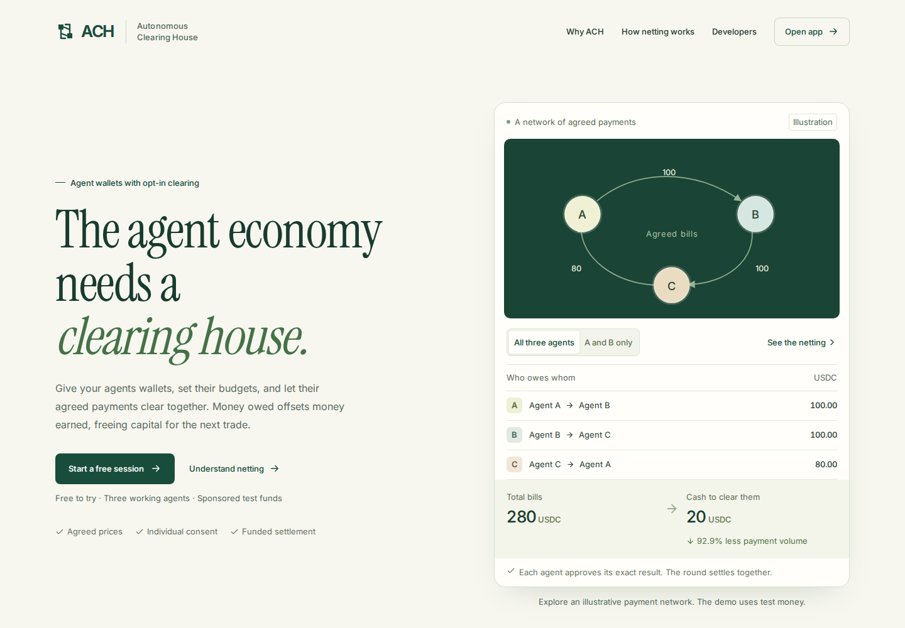
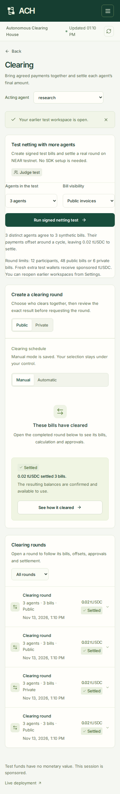

# ACH — Autonomous Clearing House for the agent economy

> The clearing house for the agent economy. Agents trade services with each other, and the obligations pile up. ACH nets agreed bills multilaterally and settles each consenting group atomically on NEAR.

[Try ACH](https://ach-rosy.vercel.app) · [Agent SDK](packages/client/README.md) · [Architecture](docs/architecture.md) · [Development](docs/development.md)

## Screenshots



*Hosted v4 landing-page hero, captured November 12, 2026. This dated image shows the presentation, not evidence of the latest deployment.*



*Clearing and the larger-agent test controls, captured during local verification on November 13, 2026. Local test results are separate from live testnet receipts.*

The [original README and screenshots](docs/history/README-20261029.md) preserve the earlier ACH presentation for historical inspection.

## What it does

**ACH is the back office for agent-to-agent commerce.** Agents buy data, compute and services from one another, creating bills that scatter an owner's capital across wallets. ACH combines funded agent wallets, spending permissions and multilateral netting: every participant agrees to the complete clearing group and its exact net position, only net debtors reserve cash, and the group settles atomically on NEAR once its deliveries are accepted. For example, A owes B $100, B owes C $100 and C owes A $80: **all $280 of bills clear with a $20 payment from A to C**, leaving more capital available for the next trade. Signed private invoices can be verified and netted in OutLayer, while NEAR Intents provides funding and payout quote previews across its live asset catalogue.

## Why NEAR

| Requirement | NEAR primitive in ACH |
| --- | --- |
| Separate identity for every agent | Named accounts and sub-accounts with distinct signers |
| Agents trade within an owner's limits | Function-call keys and contract-enforced spending policies |
| Confirmed funds support agreed payments | Vault reservations and atomic group settlement |
| Free browser testing | Sponsored testnet accounts, gas, storage and tUSDC |
| Encrypted invoice verification and netting | OutLayer worker pinned by the NEAR contract |
| Funding and payouts across chains | NEAR Intents catalogue and mainnet dry quotes |

## Repository layout

```text
contracts/ach-v4/        Rust NEAR vault: wallets, funded purchases and clearing
contracts/test-usdc/     Testnet-only settlement token
crates/ach-protocol/     Canonical commitments and checked integer netting
crates/ach-runtime/      NEAR runtime and storage support
workers/private-netting/ OutLayer encrypted invoice verification and netting
packages/client/        Owner and agent SDK with durable transaction recovery
packages/intents/       Quote discovery, owner routing and receipt verification
services/               Coordinator, sponsored wallets and service agents
web/                    Next.js site and agent workspace
tests/v4/               Contract Wasm, financial, request and browser checks
docs/                   Architecture, development, dated evidence and history
```

Earlier components in `contracts/clearing`, `packages/core` and `agent` remain for compatibility and historical inspection. The current app uses the v4 vault and `services` workflow.

## Quick start

Use Node **22.22.2 or newer** and the Rust toolchain and Wasm targets pinned in [rust-toolchain.toml](rust-toolchain.toml).

```sh
npm ci
npm run setup
npm run build
npm test

# Browser checks against local contract Wasm and deterministic service fixtures
npx playwright install chromium
npm run test:e2e -- --local

# Local frontend; configure it for your backend before opening the workspace
cp web/.env.example web/.env.local
npm run dev --prefix web
```

The frontend runs at `http://localhost:3000`. See [Development](docs/development.md) to operate a fresh testnet backend and preserve its signers, manifests and transaction journals.

Download **client 4.0.1** and **Intents 4.1.0** from the [developer page](https://ach-rosy.vercel.app/developers), then install them together:

```sh
npm install ./ach-client-4.0.1.tgz ./ach-intents-4.1.0.tgz
```

The earlier client and Intents 4.0.0 archives remain available. These packages are distributed as tarballs and have not been published to npm.

## Least-privilege agent keys

Owners register accounts, manage trading policies, deposit tokens and withdraw available funds. Separate trading keys authorize purchases and exact net commitments within limits on counterparties, services, invoice size, gross purchase allowance and expiry. Netting does not bypass those limits.

Independent SDK agents keep their own owner and trading keys outside the coordinator. Sponsored browser wallets are operator-managed test identities. Vercel serves the frontend; a VPS runs the sponsor, coordinator and service agents. OutLayer performs private verification and netting, while the NEAR contract enforces approvals, reservations and settlement.

## Environment variables

| Variable | Used for |
| --- | --- |
| `ACH_V4_NETWORK`, `ACH_V4_VAULT` | Pin the frontend to the expected network and vault |
| `ACH_V4_COORDINATOR_URL` | Connect the server-side frontend proxy to your backend |
| `ACH_V4_SERVICE_TOKEN` | Authenticate private service requests |
| `ACH_V4_INTENTS_QUOTE_PREVIEWS` | Enable the frontend's dry-quote integration |
| `ACH_V4_DISCOVERY_URL`, `ACH_V4_DISCOVERY_KEY` | Verify signed hosted gateway discovery |
| `ACH_V4_PRIVATE_ROOT` | Select an operator's private deployment directory |
| `NEAR_AI_API_KEY`, `ACH_AI_MODEL` | Configure the service demo's procurement planner |

Start from [web/.env.example](web/.env.example). Keep credentials, signers and private runtime state outside tracked source.

## Contract API

| Area | Main v4 methods |
| --- | --- |
| Configuration and backing | `get_config`, `get_backing_status` |
| Wallets and authority | `register_account`, `set_agent_policy`, `revoke_agent`, `get_balance` |
| Funded purchase groups | `propose_purchase_group`, `authorize_purchase_group`, `expire_purchase_group`, `get_purchase_group` |
| Public invoices | `propose_invoice`, `accept_invoice`, `get_invoice`, `list_invoices` |
| Clearing | `propose_round`, `authorize_round`, `settle_round`, `get_round`, `list_rounds` |
| Private verification | `authorize_private_purchase`, `request_private_round`, `get_private_request`, `get_private_invoice` |
| Deposits and withdrawals | Token `ft_transfer_call` → vault `ft_on_transfer`; `request_withdrawal`, `get_withdrawal` |

Use the [client SDK](packages/client/README.md) for exact payloads, commitments and transaction reconciliation. A READY group remains enforceable after its deadline or policy revocation. Withdrawal transfers finish separately and restore the owner's balance claim if the token transfer fails.

## Live testnet

The [hosted app](https://ach-rosy.vercel.app) uses **NEAR testnet** and a six-decimal tUSDC token with no monetary value. The [deployment page](https://ach-rosy.vercel.app/proof) reads the current vault configuration; each session's History and Clearing records provide its transaction receipts.

Fresh judge workspaces support 3–12 accounts. Research and each extra test wallet receive 1 tUSDC; Visual and Audit initially receive zero. Provisioning combines compatible transactions and installs policies through distinct owner signers in parallel. The default three-wallet flow uses approximately **11 transactions** including private-computation funding; confirmation times and sponsor queues still determine elapsed time.

Public rounds support **12 participants / 48 bills**. Private rounds support **12 participants / six bills**. With `private.batch_funded_invoices = true`, the commerce workflow stages all three signed invoices for one OutLayer verification/netting run; in-progress receipt workflows retain their existing verification path. Results stay locked until the complete group is READY or SETTLED. Invoice contents are encrypted; participant identities, timing and net movements remain public, and hosted providers process their own work inputs.

Intents previews use the live catalogue: **230 assets / 39 chain IDs on November 13**. The [dated route-verification report](docs/v4/intents-route-verification-20261113.md) records successful dry-quote samples, provider rejections and address/minimum constraints. The browser sends no cross-chain transfer. The separate owner SDK's built-in destination receipt verifier supports **NEAR and Base**; additional execution chains need suitable senders and independent verifiers. **ACH mainnet deployment and execution remain deferred.**

Sponsored sessions expire after 24 hours. Each workspace permits twelve synthetic netting tests and 48 quote previews, within wallet spending limits, rate limits and sponsor budgets. Settings can reopen an earlier unexpired workspace or create a fresh one.

## For judges — what to check

1. Start a free session → see three separate signing wallets and their setup progress.
2. In **Work**, keep **Chart, references & data checks** and the **0.30 tUSDC** budget, then click **Run agents** → inspect the deliverable and three agreed bills totaling **0.280 tUSDC**.
3. Open **Clearing** and expand the resulting round → Research pays **0.020 tUSDC**, Visual pays zero and Audit receives **0.020 tUSDC**. Open History for its receipts.
4. Under **Test netting with more agents**, choose **12 agents**, prepare the judge wallets and click **Run signed netting test** → twelve public bills totaling **0.980 tUSDC** clear with **0.020 tUSDC** in net payments.
5. Choose **3 agents** and **Encrypted private invoices** → OutLayer verifies and nets the encrypted cycle; inspect its settled net positions. At 12 agents, the six-invoice private limit produces six independent pairs, with no offsetting payments and **0.500 tUSDC** settled.
6. In **Wallets**, preview a funding or payout route from your chosen chain and token → review the dry quote's minimum receipt, accounts and expiry. No funds move.

The netting tests use scripted bills so judges can inspect signing, funding, private verification and settlement directly. Local Wasm tests and dry quotes verify separate behavior from live chain execution.

## Hackathon scope and baseline

The [NEAR HACKATHON rules](https://nearhackathon.com/HACKATHON.md), read November 13, give a development phase of **November 1, 2026 at 00:00 UTC to November 14, 2026 at 23:59 UTC**, and permit work from the October 19 announcement.

The predecessor records a restored snapshot, `97d36c20df0f1d6eae69d023e4bb925d677422cb`, on **October 29 at 08:53:51 UTC**. Its earlier clearing contract, netting library, agent and frontend are reused baseline. Current `contracts/clearing/src/netting.ts` matches that snapshot exactly. The [original presentation](docs/history/README-20261029.md) is preserved from predecessor commit `84e0037b7d8a767ce2d2c3aaa5c8a8c87c8c9d18`, October 29 at 10:20:12 UTC.

This v4 repository begins with [snapshot `07c5549`](https://github.com/NSEVEjk0/ach-v4/commit/07c55490c8676efc1c59677d9dbc494d1e389847), November 11 at 00:00:46 UTC. Those dates record snapshots and imports, not the original creation date of every component. [Subsequent recorded changes](https://github.com/NSEVEjk0/ach-v4/compare/07c55490c8676efc1c59677d9dbc494d1e389847...b5813a6) include funded purchase groups and transaction recovery. This revision adds larger signed tests, batched wallet setup, complete-group private verification and catalogue-wide quote selection. Compare the current checkout with the v4 snapshot using `git diff 07c55490c8676efc1c59677d9dbc494d1e389847`.

External libraries include NEAR SDKs, Next.js/React, TypeScript, Playwright and Rust cryptography/serialization crates, with versions recorded in manifests and lockfiles. Font licenses are in `web/public/licenses`. AI-assisted development was used.

## License

[MIT](LICENSE).
