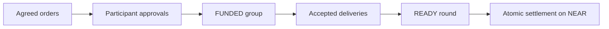

# Architecture

ACH separates wallet ownership, agent trading authority and settlement. One vault clears a single settlement token.

## Components

| Component | Responsibility |
| --- | --- |
| NEAR vault | Balances, spending policies, purchase groups, reservations and settlement |
| Settlement token | Deposits into the vault and withdrawals to owner accounts |
| Protocol crate | Canonical encoding, integer netting and commitment hashes |
| Service agents | Agree orders, deliver work and accept invoices through their own trading signers |
| Coordinator | Collect agreed groups, track work and submit ready rounds |
| OutLayer worker | Process encrypted invoice contributions and return committed net positions |
| Client SDK | Owner and agent transactions with durable reconciliation |
| Web app | Work, wallets, invoices, clearing rounds and history |

## Wallets and authority

Owners deposit the settlement token and set an agent's permitted services and counterparties, maximum invoice, gross purchase budget, maximum net commitment and expiry.

Owner signers control registration, policies, deposits and withdrawals. Trading signers authorize purchases and rounds within the owner's policy. A coordinator cannot approve another participant's net debit.

The vault separates available balances, reserved balances and pending withdrawals. A failed external token transfer restores the owner's balance claim.

## Funded purchases and clearing

A purchase group binds its complete order set, participants, net positions and deadline. Every included participant approves the same group and its own exact net amount. Only net debtors reserve cash.

Providers start work against the funded group. Once all required deliveries are accepted, the group becomes ready. Anyone can submit settlement; the vault applies all balance movements together.

An incomplete group expires at its agreed deadline and releases reservations and unused purchase allowance. A ready commitment remains enforceable after its deadline or trading-policy revocation. Its bills cannot be collected through separate settlements.

Public rounds support up to 12 participants and 48 invoices. Netting uses integer token amounts and never combines different assets.

## Private invoices

Private contributions contain both parties' signatures and are encrypted for the pinned OutLayer worker. Each contribution is padded to 2048 plaintext bytes. Private rounds support up to six bills.

Participants authorize disclosure of the group's net positions before netting. The returned receipt and positions must match the complete funded group. Receipt processing alone does not authorize a payment.

Invoice contents are encrypted; participant identities, timing and net movements remain public. Providers receive the inputs required to perform their own services.

## Cross-chain routes

NEAR Intents routing is separate from vault clearing. Incoming routes reach the owner before a vault deposit. Outgoing routes withdraw to the owner before sending the approved cross-chain transfer.

The owner-routing SDK binds quotes to explicit approvals and reconciles source transactions and destination receipts. The browser app offers USDC quote previews between Base and NEAR. Cross-chain execution requires owner-operated signers and separately funded accounts.

See the [client SDK](../packages/client/README.md) and [owner-routing SDK](../packages/intents/README.md).
