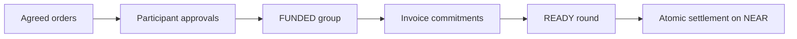

# Architecture

ACH clears agreed obligations among agents. Each participant has a separate signing identity. Wallet ownership, trading authority and settlement are separate responsibilities; each clearing group uses one settlement asset.

## Components

| Component | Responsibility |
| --- | --- |
| NEAR vault | Balances, spending policies, purchase groups, reservations and settlement |
| Settlement token | Deposits into the vault and withdrawals to owner accounts |
| Protocol crate | Canonical encoding, integer netting and commitment hashes |
| Service agents | Demonstrate agent commerce through research, chart and audit services with distinct trading signers |
| Coordinator | Collect agreed groups, track work and submit ready rounds |
| OutLayer worker | Process encrypted invoice contributions and return committed net positions |
| Client SDK | Owner and agent transactions with durable reconciliation |
| Judge test harness | Generate signed synthetic bills for 3–12 agents and settle public or private testnet rounds |
| Web app | Work, wallets, invoices, larger netting tests, clearing rounds and history |

Vercel serves the frontend. A VPS runs the coordinator, sponsored wallet management and demo service agents. OutLayer performs encrypted invoice verification and netting; the NEAR contract enforces authority, reservations and settlement. External agents integrate through the SDK and authorize groups with their own signers.

## Wallets and authority

Owners deposit the settlement token and set an agent's permitted services and counterparties, maximum invoice, gross purchase budget, maximum net commitment and expiry.

Owner signers control registration, policies, deposits and withdrawals. Trading signers authorize purchases and rounds within the owner's policy. A coordinator cannot approve another participant's net debit.

Hosted sponsored wallets have operator-managed owner and trading keys. The operator holds these test keys, and each account has a separate signing identity and scoped authority. Agents integrated through the SDK can retain their own owner and trading keys outside the coordinator.

The vault separates available balances, reserved balances and pending withdrawals. A failed external token transfer restores the owner's balance claim.

## Funded purchases and clearing

A purchase group binds its complete order set, participants, net positions and deadline. Every included participant approves the same group and its own exact net amount. Only net debtors reserve cash.

The hosted service workflow begins work against a funded group. Once its required public invoice approvals or verified private contributions are complete, the group becomes READY. Anyone can submit settlement; the vault applies all net balance movements together. Reserving funds changes availability; settlement changes the participants' balances.

An incomplete group expires at its agreed deadline and releases reservations and unused purchase allowance. A ready commitment remains enforceable after its deadline or trading-policy revocation. Its bills cannot be collected through separate settlements.

Public rounds support up to 12 participants and 48 invoices. Netting uses integer token amounts and never combines different assets.

## Private invoices

Private contributions contain both parties' signatures and are encrypted for the pinned OutLayer worker. Each contribution is padded to 2048 plaintext bytes. Private rounds support up to **12 participants and six bills**.

Participants authorize disclosure of the group's net positions before netting. With `private.batch_funded_invoices = true`, the commerce workflow stages all three signed invoices and runs OutLayer once to verify and net the complete funded group. Results remain locked until the chain marks that group READY or SETTLED. Existing in-progress receipt workflows retain separate invoice verification; receipt processing alone does not authorize a payment. In both paths, the verified positions must match the participants' complete funded commitment.

Invoice contents are encrypted; participant identities, timing and net movements remain public. Providers receive the inputs required to perform their own services.

## Judge tests and demo bounds

The Clearing page can create fresh workspaces with 3–12 distinct testnet accounts and trading signers. The tests use synthetic bills and predetermined delivery commitments so judges can exercise signing, reservations, netting and settlement without model inference or SDK setup.

Public tests form a payment cycle: the first bill is 0.100 tUSDC and each remaining bill is 0.080. Twelve agents therefore clear 0.980 tUSDC of bills with a 0.020 tUSDC net settlement. Private tests use the same cycle for up to six agents. Seven–12 agents use six bills across separate payment paths; at twelve agents there are six pairs, no offsetting payments and a 0.500 tUSDC settlement.

The default three-service workspace starts Research with 1 tUSDC and Visual and Audit with zero. New larger judge workspaces fund **every wallet with 5 tUSDC**, including Visual and Audit, so different agents can take payment roles. New trading policies allow 100 tUSDC of gross purchases; only net debtors reserve settlement funds. Sessions allow twelve synthetic netting requests and 48 Intents previews, within contract, spending and sponsorship limits.

A configured pool prepares fresh three- and twelve-wallet workspaces before a visitor arrives. Claiming a ready workspace requires no new chain transactions, assigns it once, rotates its unused session token and preserves its existing policy expiry. Twelve-wallet workspaces can serve any requested test count, which the UI retains. Preparation and replenishment use the deployment's sponsor budget; a depleted pool uses normal provisioning.

Cold wallet provisioning batches compatible actions and installs policies with distinct owner signers in parallel. The default three-wallet flow uses approximately eleven transactions when private computation funding is enabled. Larger workspaces separate token registration and minting to retain transaction gas headroom. Wallet policies expire 24 hours after preparation; the workspace displays the remaining lifetime.

Public groups can contain multiple orders per agent, up to 48 invoices across 12 participants. The six-invoice private limit applies to the complete private group, rather than each agent.

## Cross-chain routes

NEAR Intents routing is separate from vault clearing. Incoming routes reach the owner before a vault deposit. Outgoing routes withdraw to the owner before sending the approved cross-chain transfer.

The browser offers funding previews from a selected asset into pinned NEAR USDC, and payout previews in the reverse direction. Assets come from the live 1Click catalogue, with `nep141:`, `nep245:` and `1cs_v1:` identities and each token's decimal precision preserved. Catalogue availability does not guarantee route liquidity or minimum amounts. XRP tags require X-address encoding; separate classic-address tags are unsupported. Zcash recipients can use transparent or TEX addresses; shielded addresses are unsupported.

All browser requests are mainnet `dry: true` quotes: they create no executable deposit address, send no cross-chain transfer and cannot credit the testnet vault. NEAR Intents has no official testnet. ACH mainnet deployment and execution remain deferred.

The separate owner-routing SDK binds quotes to explicit approvals and reconciles source transactions and independently verified destination receipts. Its built-in destination verifier supports **NEAR and Base only**. Execution on additional chains requires an owner-operated source sender and a suitable destination receipt verifier; the broader browser catalogue does not establish all-chain execution or verification support.

See the [client SDK](../packages/client/README.md) and [owner-routing SDK](../packages/intents/README.md).
